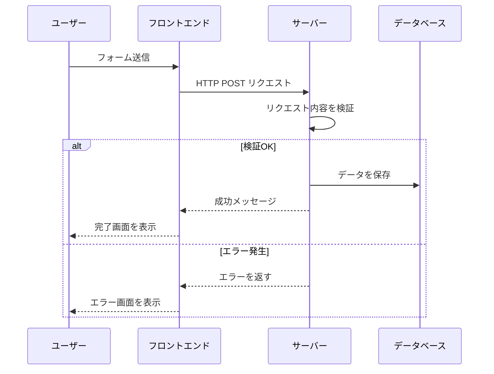

# 文の推敲と図表化の詳細基準（Step 5 の実行資料）

SKILL.md の Step 5（文を書く）を実行するとき、および文・図表の推敲を求められたときに、このファイルの基準と改善前→改善後の実例を適用する。各文は ①必要な情報を正しく得られる ②効率よく理解できる ③余計な負担なく受け止められる、を満たす。

## A. 効率よく理解できる（素早く要点を取れる）

| 工夫 | やり方 | 改善前 → 改善後 |
|------|--------|----------------|
| 重要なことから書く | 結論・要点を先頭に（一部しか読まれない前提で優先度をつける） | 理由を並べてから結論 →「業務でのスマホ活用は生産性向上につながる」を先頭に |
| 読み手の視点で書く | 仕組みの説明でなく、読み手が**得るもの・すべき操作**で書く | 「定期的にチェックし自動更新します」→「有効にすると常に最新版を使えます」 |
| 能動態と受動態を使い分ける | 主語に立てたいもの（動作主か対象か）で選ぶ | 「自動的にアプリをアップデートします」→「アプリが自動的にアップデートされます」 |
| 簡潔に・一文一義 | 1文に含める情報を減らす。長い説明は複数文に、手順は番号リストに分ける | 「設定を選択し Wi-Fi を選択したのちオンにします」→ 1.設定 2.Wi-Fi 3.オン |
| 並列を見える化 | 「や」「と」の連発をやめ、読点・中点で区切る | 「AやBやC」→「A・B・C」 |

## B. 正しく理解できる（誤解させない）

| 工夫 | やり方 | 改善前 → 改善後 |
|------|--------|----------------|
| 具体的に書く | 抽象語・曖昧語（「適宜」「なるべく」「早めに」「等」）を数値・条件・状態に | 「早めに終わる見込み」→「通常10分ほどで完了します」／「音量設定を確認」→「消音になっていないか確認」 |
| 係り受けを明確に | 読点・語順で修飾の係りを一意に。指示語の指す先も一意に | 「簡単なチャットアプリの作り方」→「チャットアプリの簡単な作り方」 |
| 肯定形で書く | 「〜しないで」を「〜してください」に言い換える | 「放置しないでください」→「早めに適用してください」 |

## 箇条書き・読点の使いどころ

**箇条書きは重要な情報だけに使う**。視覚的に目立つので、軽い並列にまで使うと「重要そう」に見えて逆効果。**目安**: 3項目以上で各項目が独立した操作・手順・選択肢なら箇条書き、語句の羅列（軽い並列）なら読点・中点で十分。例:「参加者管理・メッセージ削除・ルーム削除ができる」は中点、一つずつ実行させたい手順なら箇条書き。

**読点は多機能**。並列・係り受けのほか、理由／条件／目的の切れ目、節の区切り、接続の強調にも効く。読みにくい1文は、まず読点の位置と数を疑う。

## 項目が多いときはまとまりに分ける（チャンク化）

**多くの項目をフラットに並べず、意味のまとまり（チャンク）に分けて名前を付ける。** 人が一度に頭に置いておける項目の数には限りがある（ミラーの法則。Miller, 1956）。まとまりに名前があれば、読み手はその名前だけを見て必要な箇所に当たりをつけられる。

数値は上限として使わない。Miller は「7±2」を挙げたが、その後の研究では4前後とする見方もある（Cowan, 2001）。保てる数は読み手の前提知識や状況によっても変わる。本質は項目を減らすことではなく、まとまりに分けることにある。また、読み手が覚えずに見返せる参照用の一覧（設定値一覧・用語集など）は、項目数を理由に削らなくてよい。行が多ければ分類で区切る。

| 対象 | 分け方 | 改善前 → 改善後 |
|------|--------|----------------|
| 箇条書き | 共通点でグループにし、グループに小見出しを付ける | 注意事項12項目をフラットに列挙 →「作業前」「作業中」「作業後」の3グループに分け、それぞれに小見出し |
| 手順 | 段階ごとに区切り、段階に名前を付ける | 15ステップの番号リスト →「準備」「設定」「動作確認」の3段階に分け、段階ごとに番号を振り直す |
| 見出し | 同じ階層に並ぶ見出しをまとめる上位の見出しを足す | `##` が10個並ぶ → 3〜4個の `##` の下に `###` として振り分ける |
| 表 | 行を分類ごとに区切る | 設定項目20行の表1つ →「接続」「認証」「ログ」の小見出しごとに表を分ける |
| 長い数字・ID | 区切りを入れる | 「0312345678」→「03-1234-5678」 |

箇条書きの例（項目は同じ12個のまま、分けて名前を付けただけ）:

```
改善前:
リリース前に確認すること
- テストがすべて通っている
- 変更履歴を更新した
- 本番用の環境変数を設定した
- マイグレーションを検証環境で実行した
- ロールバック手順を用意した
- 関係者にリリース日を連絡した
- 監視のアラート先を確認した
- バージョン番号を上げた
- 依存ライブラリの脆弱性を確認した
- 問い合わせ窓口に変更点を共有した
- バックアップを取得した
- リリースノートを書いた

改善後:
リリース前に確認すること

コード
- テストがすべて通っている
- 依存ライブラリの脆弱性を確認した
- バージョン番号を上げた

環境・データ
- 本番用の環境変数を設定した
- マイグレーションを検証環境で実行した
- バックアップを取得した
- ロールバック手順を用意した
- 監視のアラート先を確認した

周知
- 変更履歴を更新した
- リリースノートを書いた
- 関係者にリリース日を連絡した
- 問い合わせ窓口に変更点を共有した
```

分け方の軸は、SKILL.md Step 2 の分解と同じく読み手の目的で選ぶ。作業の順に使う読み手なら段階で、担当ごとに分担する読み手なら担当で分ける。

項目が1つしか入らないまとまりは、意味の近いまとまりに入れ、そのまとまりの名前に含める（例: 「認証」に入れて「認証・アクセス制限」とする）。近いまとまりが無く、入れると名前が中身を表さなくなるなら、1項目のまま独立させてよい。「その他」のような中身の読み取れない名前で受けない。

## 否定形の使い分け

回りくどい禁止・指示の否定（「放置しないでください」）は肯定形（「早めに適用してください」）に直す。一方、利得や事実を表す自然な否定（「他の案件と混ざらない」「手間が減る」）はそのまま使ってよい。「してほしくないこと」を**強調**したいときは、あえて否定形にする。

## 図表で表す（文章より速いとき）

人間は文字を読むより、図で直感的に示されたほうが理解が速い。**文章で追うのが面倒な関係・流れは、図表にする。** ただし**作りすぎない**——単純な事実や短い列挙まで図にすると、かえって読みにくい。

**図にする目安**: 複数の登場人物（アクター）の間を情報が行き来するフロー。例「ユーザーがフォームを送信し、データが DB に保存されるまで」くらいの粒度なら図にする。**シーケンス図を推奨**。

この例を図にすると、文章より関係が一目で掴める:



中身に合った図表を選ぶ: 複数アクターのやりとりは**シーケンス図**、並列の対比は**表**、状態の移り変わりは**状態遷移図**、手順は**番号リスト**。
